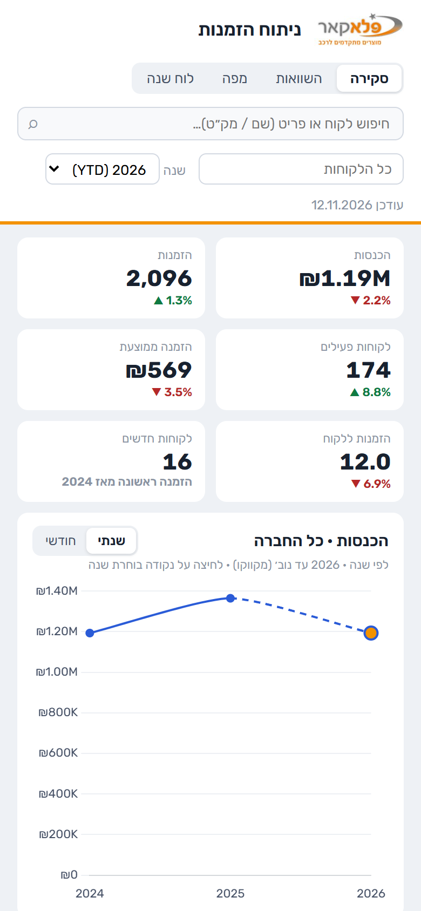
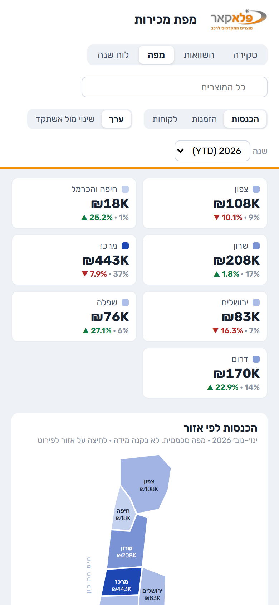
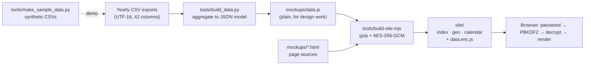

<div dir="rtl">

## דאשבורד מכירות – פלאקאר

דאשבורד סטטי בעברית לניתוח הזמנות של יבואן אביזרי רכב: סקירה עם מדדים מול אשתקד, השוואות בין שנים, מפת מכירות לפי אזורים ולוח שנה עם לקוחות לפנות אליהם השבוע, מוצרים להבליט ורעיונות למבצעים. הנתונים נבנים מקובצי ה-CSV של מערכת הנהלת החשבונות ומוצפנים בסיסמה. **בריפו הזה יש רק נתונים סינתטיים** (לקוחות, מוצרים וסכומים מומצאים). סיסמת ההדגמה: `demo`.

</div>

---

# Flacar Sales Dashboard

A static, password-protected sales analytics site for a car-accessories importer. Yearly invoice exports from
the accounting system are turned into a compact JSON model by a Python script, encrypted in the browser-friendly
AES-GCM format by a Node script, and explored on three mobile-friendly pages: overview, sales map and a
weekly action calendar.

> **All data in this repository is synthetic.** Customers, products, addresses, phone numbers and amounts are
> generated by [`tools/make_sample_data.py`](tools/make_sample_data.py). The company name appears only as project context.
> **Demo password:** `demo`

## Screenshots

| Password gate | Overview | Sales map | Weekly calendar |
|---|---|---|---|
|  |  |  |  |

## Features

- **Overview.** Revenue, orders, average order, active and new customers, orders per customer, each against the
  same period last year; yearly and monthly revenue charts; search by customer or item (name or SKU).
- **Customer and item drill-down.** Per-customer order history and trend; per-item sales by month and by customer.
- **"Bought together".** Item pairs that appear on the same order far more often than chance (lift ≥ 2, 3+ orders).
- **Sales map.** Revenue, orders or customers by region on a schematic map of Israel, with year-over-year change.
- **Weekly calendar.** Customers to call each day (regulars who are overdue relative to their own ordering rhythm),
  products to highlight for the season, and promotion ideas derived from the data.
- **Accounting-aware model.** Credit notes reduce revenue and returned units but do not count as orders;
  a shared walk-in account is detected and not treated as one customer.
- **Client-side encryption.** The data file is gzip + AES-256-GCM with a PBKDF2-SHA256 key (310,000 iterations).
  The browser derives the key from the password; the derived key is cached for 12 hours so pages switch instantly.

## Tech stack

| Layer | Tools |
|---|---|
| Data pipeline | Python 3 (`csv`, `collections`; optional `openpyxl` for `.xlsx` exports) |
| Build / encryption | Node.js (`crypto`, `zlib`), no dependencies |
| Front end | Plain HTML, CSS and JavaScript, Chart.js (CDN), Web Crypto API, `DecompressionStream` |
| Hosting | Any static host (originally Netlify) |

## Architecture



| Path | What |
|---|---|
| `mockups/` | Page sources with inline scripts, reading `data.js` in the clear (`mockup-3-analytical.html` is the main page; 1 and 2 are earlier design directions) |
| `site/` | The built, deployable site: each page's script split out and loaded only after the data is decrypted |
| `tools/build_data.py` | CSV → JSON model (monthly totals, customers, items, orders, item pairs) |
| `tools/build-site.mjs` | Encrypts the model and builds `site/` from the mockups |
| `tools/make_sample_data.py` | Generates realistic synthetic exports with the same columns as the real ones |

## Run locally

Requires Python 3 and Node 18+.

```bash
# 1. Generate synthetic exports into sample-data/ (git-ignored, about 9 MB)
python tools/make_sample_data.py sample-data

# 2. Aggregate them into the data model
python tools/build_data.py sample-data mockups/data.js

# 3. Build the encrypted site with the demo password
node tools/build-site.mjs demo

# 4. Serve it
python -m http.server 8766 --directory site
```

Open http://localhost:8766 and enter `demo`. The committed `site/` and `mockups/data.js` are already built from
synthetic data, so step 4 alone is enough to look around. The mockups can be served the same way
(`--directory mockups`) and need no password.

## Deploy

Upload the `site/` folder to any static host (Netlify Drop, GitHub Pages, S3). For real data, run the pipeline on
your own exports with a strong password; `build-site.mjs` without an argument generates one and saves it to
`site-password.txt`, which is git-ignored. Never commit real exports or `mockups/data.js` built from them.

## License

[MIT](LICENSE)
