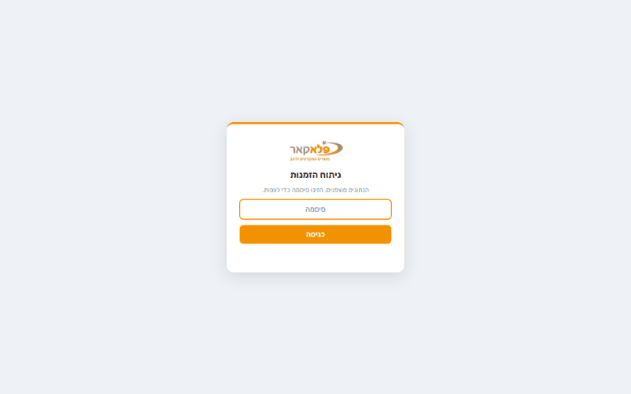
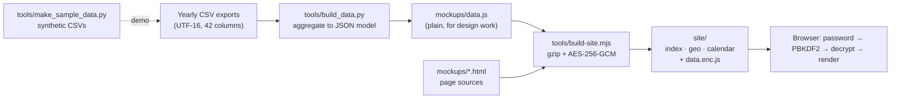

**[▶ Try the live demo](https://roeiraz12.github.io/flacar-sales-dashboard/)** (password: `demo`, synthetic data)

[](https://github.com/roeiraz12/flacar-sales-dashboard/actions/workflows/ci.yml)
[](https://github.com/roeiraz12/flacar-sales-dashboard/actions/workflows/pages.yml)
[](LICENSE)



*Unlocking the dashboard with the demo password, then browsing the overview, the sales map and the weekly calendar.*

<div dir="rtl">

## דאשבורד מכירות – פלאקאר

דאשבורד סטטי בעברית לניתוח הזמנות של יבואן אביזרי רכב: סקירה עם מדדים מול אשתקד, השוואות בין שנים, מפת מכירות לפי אזורים ולוח שנה עם לקוחות לפנות אליהם השבוע, מוצרים להבליט ורעיונות למבצעים. הנתונים נבנים מקובצי ה-CSV של מערכת הנהלת החשבונות ומוצפנים בסיסמה. **בריפו הזה יש רק נתונים סינתטיים** (לקוחות, מוצרים וסכומים מומצאים). סיסמת ההדגמה: `demo`.

</div>

---

# Flacar Sales Dashboard

A static, password-protected sales analytics site for a car-accessories importer. Yearly invoice exports from
the accounting system are turned into a compact JSON model by a Python script, encrypted in the browser-friendly
AES-GCM format by a Node script, and explored on three mobile-friendly pages: overview, sales map and a
weekly action calendar.

> **All data in this repository is synthetic.** Customers, products, addresses, phone numbers and amounts are
> generated by [`tools/make_sample_data.py`](tools/make_sample_data.py). The company name appears only as project context.
> **Demo password:** `demo`

## Screenshots

| Password gate | Overview |
|---|---|
|  |  |
| *The data file is encrypted; nothing is shown until the password unlocks it in the browser.* | *KPIs against the same period last year, revenue trend, biggest customer changes and top items.* |

| Sales map | Weekly calendar |
|---|---|
|  |  |
| *Revenue by region on a schematic map of Israel, with year-over-year change per region and city.* | *Customers to call each day, products to highlight this season and promotion ideas.* |

## Case study

### Problem

The importer's sales history lived in yearly invoice exports from the accounting system: UTF-16 CSV files with
42 unnamed columns and one row per invoice line. Everyday questions (which customers are ordering less than last
year, which regions are growing, who is overdue for a call this week) could not be answered from those files at a
glance, and the data could not be shared as a link without exposing customer details.

### Users

Management and sales people at a car-accessories importer. They work in Hebrew (right-to-left), are not
analysts, and need the numbers on a phone as well as on a desktop, so every page is mobile-friendly and built
around a concrete question.

### My role

I designed and built the project end-to-end: the data model and accounting rules, the Python aggregation
script, the Node build and encryption step, the three pages (layout, charts, interactions) and the synthetic data
generator for this public version.

### Key decisions

- **Static site with client-side encryption instead of a server.** The whole site is plain files on a static host.
  The data is gzip-compressed and encrypted with AES-256-GCM, with the key derived from the password by
  PBKDF2-SHA256 (310,000 iterations); the browser decrypts it with the Web Crypto API. There is no backend, database
  or login service to run, secure or pay for, and the encrypted file is useless without the password.
- **Python + Node pipeline from the ERP exports.** Python (standard library only) reads the raw CSV exports and
  applies the accounting rules into a compact JSON model; Node (no dependencies) encrypts it and splits each page so
  its script loads only after the data is unlocked. Updating the site means dropping in new exports and re-running
  the two scripts.
- **Synthetic data for the public repository.** The real exports never leave the owner's machine.
  `tools/make_sample_data.py` generates files with the same layout (UTF-16, 42 columns, credit notes, a walk-in
  account, seasonality), so the pipeline, the demo and CI all run on realistic but invented data.

### Challenges

- **Accounting semantics.** Credit notes have to reduce revenue and returned units without counting as orders,
  and a shared walk-in account has to be recognised so it is not treated as one large customer.
- **Raw export format.** No header row, UTF-16 encoding and day-first dates, with optional `.xlsx` input as well.
- **Fast pages despite strong key derivation.** PBKDF2 with 310,000 iterations is deliberately slow, so the derived
  key is cached for 12 hours and switching pages does not ask for the password again.
- **Useful recommendations from order history alone.** "Customers to call" compares each regular customer with
  their own ordering rhythm instead of a fixed threshold, and "bought together" pairs require a lift of at least 2
  across 3 or more orders to filter out coincidences.

### Outcome

The sales history became a link the team opens on a phone: year-over-year KPIs, region and customer trends,
and a weekly list of whom to call and what to promote, without running a server. This repository is a
public, synthetic-data copy of that site, with a live demo, a reproducible build and CI that rebuilds it on every
push.

### Roadmap

- Automate the data refresh (scheduled export, build and deploy) instead of running the scripts by hand.
- Per-user passwords or key wrapping, so access can be revoked for one person without changing everyone's password.
- Unit tests for the accounting rules in `build_data.py` (credit notes, walk-in account, item pairs).
- An English interface option next to the Hebrew one.
- Export of the weekly call list to a spreadsheet or calendar.

## Features

- **Overview.** Revenue, orders, average order, active and new customers, orders per customer, each against the
  same period last year; yearly and monthly revenue charts; search by customer or item (name or SKU).
- **Customer and item drill-down.** Per-customer order history and trend; per-item sales by month and by customer.
- **"Bought together".** Item pairs that appear on the same order far more often than chance (lift ≥ 2, 3+ orders).
- **Sales map.** Revenue, orders or customers by region on a schematic map of Israel, with year-over-year change.
- **Weekly calendar.** Customers to call each day (regulars who are overdue relative to their own ordering rhythm),
  products to highlight for the season, and promotion ideas derived from the data.
- **Accounting-aware model.** Credit notes reduce revenue and returned units but do not count as orders;
  a shared walk-in account is detected and not treated as one customer.
- **Client-side encryption.** The data file is gzip + AES-256-GCM with a PBKDF2-SHA256 key (310,000 iterations).
  The browser derives the key from the password; the derived key is cached for 12 hours so pages switch instantly.

## Tech stack

| Layer | Tools |
|---|---|
| Data pipeline | Python 3 (`csv`, `collections`; optional `openpyxl` for `.xlsx` exports) |
| Build / encryption | Node.js (`crypto`, `zlib`), no dependencies |
| Front end | Plain HTML, CSS and JavaScript, Chart.js (CDN), Web Crypto API, `DecompressionStream` |
| Hosting | Any static host; the demo runs on GitHub Pages |

## Architecture



| Path | What |
|---|---|
| `mockups/` | Page sources with inline scripts, reading `data.js` in the clear (`mockup-3-analytical.html` is the main page; 1 and 2 are earlier design directions) |
| `site/` | The built, deployable site: each page's script split out and loaded only after the data is decrypted |
| `tools/build_data.py` | CSV → JSON model (monthly totals, customers, items, orders, item pairs) |
| `tools/build-site.mjs` | Encrypts the model and builds `site/` from the mockups |
| `tools/make_sample_data.py` | Generates realistic synthetic exports with the same columns as the real ones |

## Run locally

Requires Python 3 and Node 18+.

```bash
# 1. Generate synthetic exports into sample-data/ (git-ignored, about 9 MB)
python tools/make_sample_data.py sample-data

# 2. Aggregate them into the data model
python tools/build_data.py sample-data mockups/data.js

# 3. Build the encrypted site with the demo password
node tools/build-site.mjs demo

# 4. Serve it
python -m http.server 8766 --directory site
```

Open http://localhost:8766 and enter `demo`. The committed `site/` and `mockups/data.js` are already built from
synthetic data, so step 4 alone is enough to look around. The mockups can be served the same way
(`--directory mockups`) and need no password.

## Deploy

The demo is deployed to GitHub Pages by [`.github/workflows/pages.yml`](.github/workflows/pages.yml) on every push
that changes `site/`; [`.github/workflows/ci.yml`](.github/workflows/ci.yml) regenerates the synthetic data, runs
the whole pipeline and checks that the built data file decrypts with the demo password. To host it elsewhere, upload
the `site/` folder to any static host (Netlify Drop, S3). For real data, run the pipeline on
your own exports with a strong password; `build-site.mjs` without an argument generates one and saves it to
`site-password.txt`, which is git-ignored. Never commit real exports or `mockups/data.js` built from them.

## License

[MIT](LICENSE)
